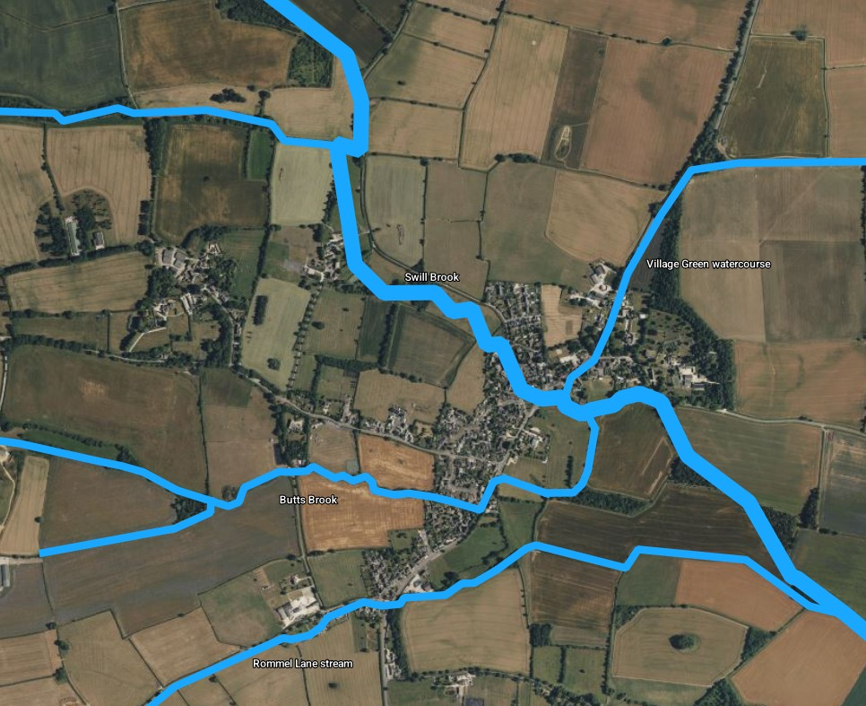
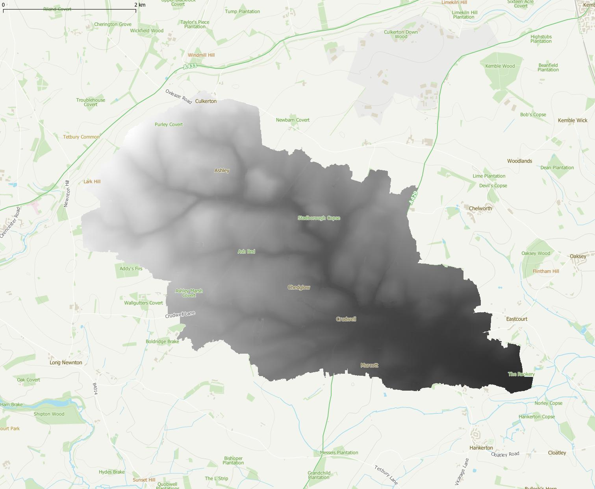
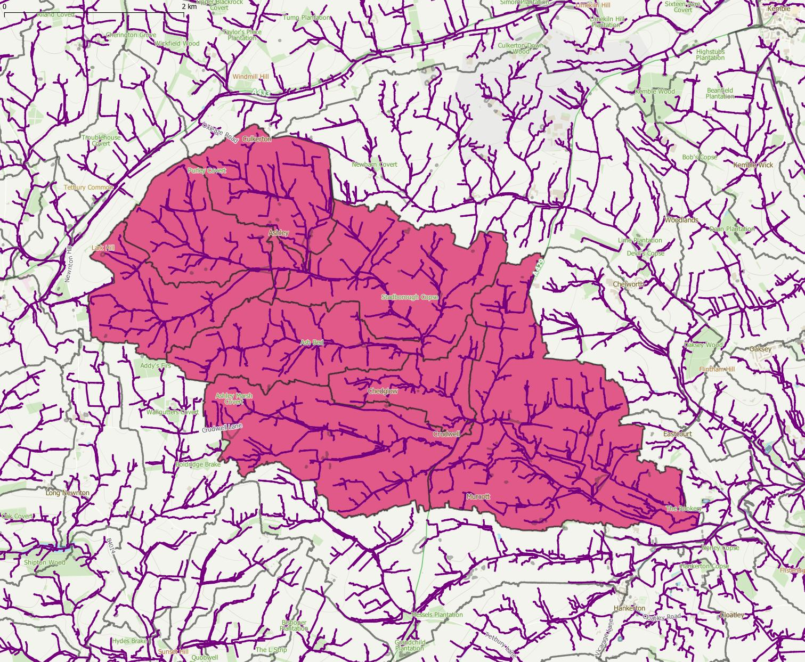
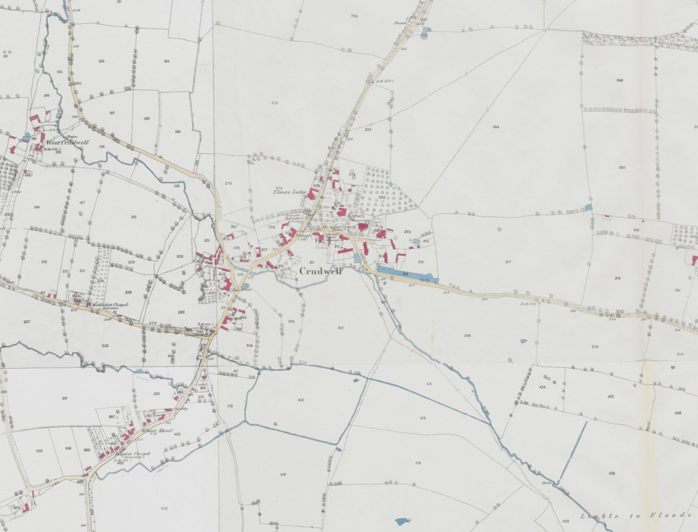

As part of showing that we understand the land around us, we've researched existing mapping and now we create our own maps. These Crudwell area maps were created using [QGIS](https://qgis.org/), a free open source cartographic software application for PC, Mac, and Linux.

## Main watercourses

Satellite imagery © Microsoft Bing Maps.

The watercourses in Crudwell village are:
1. The [Swill Brook](https://en.wikipedia.org/wiki/Swill_Brook), which rises near [Ashley, Gloucestershire](https://en.wikipedia.org/wiki/Ashley,_Gloucestershire).
2. Butts Brook, a stream that flows through a road culvert in centre of the village.
3. The Rommel Lane stream, which flows through a road culvert at the south end of the village.
4. The Village Green watercourse, which flows parallel to the A429 from the north.

## Catchment area

LIDAR data from the [National LIDAR Programme](https://www.data.gov.uk/dataset/f0db0249-f17b-4036-9e65-309148c97ce4/national-lidar-programme) used under [Open Government License](https://www.nationalarchives.gov.uk/doc/open-government-licence/version/3/) © Environment Agency 2022.

## Flow pathways

[Overland Flow Pathways](https://environment.data.gov.uk/dataset/36e7f4d3-61b2-4e64-aaa2-2b85bceb61a9) used under [Open Government License](https://www.nationalarchives.gov.uk/doc/open-government-licence/version/3/) © Environment Agency 2023.

## Crudwell area in C19th

[OS 25-inch map from 1873-1888](https://maps.nls.uk/geo/explore/#zoom=17.2&lat=51.63465&lon=-2.06710&layers=178). Reproduced with the permission of the [National Library of Scotland](https://maps.nls.uk/).

If you're researching maps for your own community, read the [useful maps](/blog/useful-maps) blog.
