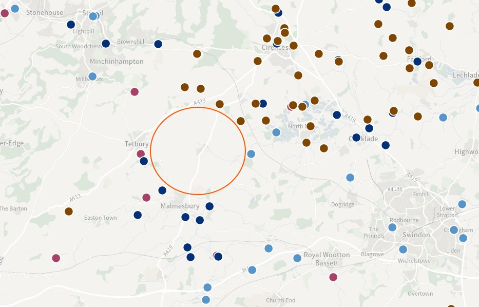

There aren't many Environment Agency monitoring stations around here, so we built our own.

## River level in a browser:

- go to **[https://wilts.riverlevels.org.uk/crudwell/river/1](https://wilts.riverlevels.org.uk/crudwell/river/1)**.
- see the depth in real-time, the predicted depth in 3hrs, rainfall, and warning levels.

## River level in an app:

- Install the Ecowitt app for **[Android🤖](https://play.google.com/store/apps/details?id=com.ost.ecowitt&hl=en-US)** or **[Apple🍏](https://apps.apple.com/gb/app/ecowitt/id1576152334)**.
- Find Crudwell on the map.
- Click on the weather station near the centre of the village - it's called `GW3000A-FLAG01`.
- Click on the three dots icon and add it to your Favourites.
- Scroll down to see the depth of the river.

The data is real-time and is available 24/7, and we hope it will work reliably in the middle of the night during the worst storm.

## Why did we do this? 

Crudwell is in the centre of this circle, with no local EA monitoring stations. We approached the EA and they said there isn't funding for new river sensors in the area.

## So what?

It causes great anxiety in a community if the rain is coming down and the river is flood and you don't know how bad its getting. You don't know what will happen overnight if there's a storm, it's not a nice feeling. Additionally, flood wardens have to go out to see the state of the river, and this isn't easy to do when its dark or when the water goes over your wellies as it has done multiple times in Crudwell.

## We think rural communities need more river monitoring

All rural communities benefit from knowing when water levels are rising and when flooding is imminent. The national tools are helpful, but they don't help residents know what's happening right on their doorstep. In our case, the nearest **[river level monitoring station](https://check-for-flooding.service.gov.uk/river-and-sea-levels/crudwell-malmesbury-wiltshire)** is 4km downstream at Oaksey. This is several hours away in terms of water flow! We think more sensors, more local knowledge, and more analytics will give rural communities better answers, and better local alerting.

Read more details about what we did in [this blog](/blog/weather-and-river-monitoring).

Contact us if you are a village or community that wants to do this, if you can fund more sensors, or if you know of a better way to do it.
